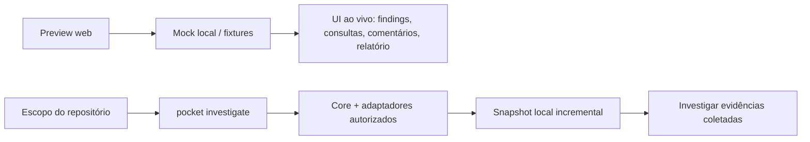

# PocketCli Investigation: guia de uso

Este guia cobre os dois caminhos da ferramenta: experimentar a interface web local em tempo real e executar a investigação pelo PocketCli dentro de um checkout Git.

## Qual fluxo usar

| Quero… | Use |
| --- | --- |
| Ver a interface, navegar em um relatório e experimentar comentários/consultas com dados previsíveis | Preview local (`cmd/investigate-preview`, sempre `DEMO`) |
| Coletar e consultar evidências reais de repositórios GitHub autorizados | `pocket investigate` no binário Agent com SQLite |



O preview não coleta dados do GitHub/Linear nem lê o checkout. Para dados reais, use o fluxo `pocket investigate`; a coleta respeita as fontes e os escopos configurados no Core.

## Experimentar ao vivo: preview local

Requer Go 1.22+. O PDF é gerado pela própria aplicação, sem browser ou Poppler.

Na raiz do repositório:

```sh
go run -buildvcs=false ./cmd/investigate-preview
```

O programa imprime um endereço `127.0.0.1` e um código temporário. Abra o endereço no navegador e informe o código na tela de desbloqueio. O código vale cinco minutos; se expirar, reinicie o processo para gerar outro.

```text
$ go run -buildvcs=false ./cmd/investigate-preview
Preview DEMO: http://127.0.0.1:<porta>
Código de desbloqueio (válido por 5 minutos): <código>
```

Depois de desbloquear, percorra a demonstração nesta ordem:

1. Abra o plano e confira os escopos e a cobertura antes de iniciar.
2. Inicie a execução e acompanhe as etapas/status atualizados ao vivo na página.
3. Abra os achados, consulte as evidências e registre comentários locais.
4. Experimente as consultas disponíveis no catálogo; uma consulta modificada fora do catálogo retorna `ERR_DEMO_QUERY_UNSUPPORTED`.
5. Gere o relatório para conferir o snapshot e o estado da exportação PDF.

O mock padrão (`complete`) traz dois achados. Para demonstrar paginação, use a fixture grande:

```sh
go run -buildvcs=false ./cmd/investigate-preview -scenario large_report
```

Outros cenários úteis: `empty`, `partial`, `unauthorized`, `rate_limited`, `offline` e `pdf_unavailable`. `-port 0` escolhe uma porta livre (padrão); `-data-dir /caminho/privado` muda o diretório de persistência. `-bind` aceita apenas loopback. Veja todas as opções com:

```sh
go run -buildvcs=false ./cmd/investigate-preview -h
```

Comentários, consultas salvas, rascunhos editoriais e relatórios persistem em `pocketcli/investigation-preview` dentro do diretório de configuração do sistema. Use `-data-dir` para separar uma sessão demonstrativa ou inspecionar os arquivos gerados.

Claude é opcional. A chave Anthropic fica em memória no processo; a listagem de modelos exige ação explícita e cada envio requer revisar e autorizar o payload exibido pela interface. Não use chaves reais em uma demonstração compartilhada.

## Investigar um repositório GitHub

Compile o binário Agent com SQLite habilitado. A partir da raiz do clone do PocketCli:

```sh
CGO_ENABLED=1 go build -buildvcs=false -tags investigate_sqlite -o /tmp/pocket ./cmd/pocket
```

Confira a saúde do motor e a sintaxe dos subcomandos:

```sh
/tmp/pocket investigate doctor
/tmp/pocket investigate --help
```

O alvo é o repositório remoto autorizado, selecionado por `--repo owner/repo` ou pelo YAML de escopo. O diretório atual não escolhe o alvo. Se você já tem um clone, use estes comandos para conferir owner/repo e branch antes de montar o escopo:

```sh
cd /caminho/para/o/projeto
git rev-parse --show-toplevel
git branch --show-current
git remote -v
```

Prepare um plano para o repositório escolhido. `--no-linear` deixa explícito que este exemplo usa apenas GitHub; `--prepare --json` imprime o plano sem iniciar coleta:

```sh
/tmp/pocket investigate --repo owner/repo --no-linear --period 90d --prepare --json
```

Defina `POCKETCLI_INVESTIGATE_GITHUB_TOKEN` com um token autorizado de leitura antes da execução (ou informe-o no prompt seguro quando a CLI pedir). Do JSON, copie `id`, `hash` e `investigation_id`; confirme o hash exato para iniciar. A execução mostra progresso no terminal e publica o snapshot:

```sh
/tmp/pocket investigate start PLAN_ID --confirm HASH
```

Para acompanhar achados e evidências numa UI local em tempo real, abra a investigação após a coleta:

```sh
/tmp/pocket investigate serve INVESTIGATION_ID
```

O servidor real usa loopback e mostra um código de desbloqueio no terminal. Na UI, selecione/configure escopo, consulte cobertura, navegue no mapa paginado e nos achados, rode SQL local protegido, registre comentários e revisões e exporte o PDF. Também dá para preparar outra coleta pelo terminal e atualizar a UI após novo snapshot. Veja sintaxe adicional em `pocket investigate refresh --help`, `serve --help` e `report --help`.

Se a coleta publicar um snapshot mas o PDF falhar, o run fica em `report_failed`. Corrija a causa informada (por exemplo, permissão do diretório de relatórios), depois use `pocket investigate report INVESTIGATION_ID --snapshot SNAPSHOT_ID` ou gere o relatório na UI. O retry é local: não consulta GitHub/Linear novamente. Depois de validar todos os achados do PDF, o run passa para `completed` ou `completed_partial`; se a exportação falhar, continua `report_failed` e o snapshot segue consultável.

Para configurar escopo YAML, `--scope` aceita arquivo local (ou `-` para stdin), até 256 KiB e schema versionado. Exemplo mínimo:

```yaml
schema_version: investigate.v1
name: auditoria-api
scope:
  mode: selected
  repositories:
    - owner/repo
  teams: []
period:
  preset: 90d
  timezone: America/Sao_Paulo
sources:
  github: true
  linear: false
modules:
  github_issues: true
  code_history: true
```

Salve como `auditoria.yaml` e prepare com `/tmp/pocket investigate --scope auditoria.yaml --prepare --json`. Os campos de módulo e limites omitidos recebem os padrões do parser; a ajuda do comando e a tabela de cobertura mostram o que o plano realmente ativará. Nunca coloque tokens no YAML.

### O que o histórico Git cobre

A coleta local registra commits alcançáveis pela ref padrão em lotes de até 100 commits novos por rodada. Um refresh com o mesmo escopo continua a fila sem republicar os commits já registrados. Os heads/branches também são inventariados; até três grafos de branches com OID novo são buscados por rodada, e refs adicionais podem continuar pendentes entre rodadas. O fetch usa o espelho Git privado local, sem executar hooks, helpers ou scripts do repositório. Por isso, trate a cobertura como incremental e leia o estado de cobertura do snapshot antes de concluir que todo o histórico foi analisado.

O recurso não é um `git log` arbitrário nem uma análise do checkout apontado pelo `pwd`: ele trabalha com os repositórios autorizados no plano/Core, e os resultados ficam vinculados ao snapshot local da investigação.

```text
Checkout Git
   │ plano + escopos autorizados
   ▼
Coleta incremental ──► snapshot local ──► achados e evidências
        │                       │
        └── nova rodada ─────────┘ (continua o trabalho pendente)
```

## Estado e arquivos locais

O preview guarda comentários em `annotations/annotations.jsonl`, consultas em `queries.jsonl`, rascunhos em `editorial/editorial.jsonl` e relatórios em `reports/`. Esses dados são locais ao usuário. A configuração do preview não é a mesma coisa que o banco/snapshot do Core usado pelo fluxo real.

Para requisitos e persistência do preview, veja [dependências do preview](luna-dependencies.md). Para a sequência de implementação do Core, cobertura e limites conhecidos, veja [implementação SOL](sol-implementation.md).
