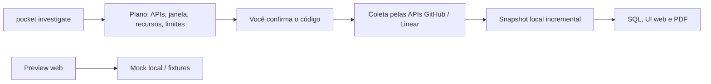

# PocketCli Investigation: guia de uso

`pocket investigate` coleta o histórico de repositórios GitHub e teams Linear **pelas APIs das duas fontes, somente leitura**, guarda um snapshot local e deixa você consultar com SQL, navegar numa interface web e exportar um PDF — tudo na sua máquina. O PDF é gerado pela própria aplicação, sem browser nem Poppler.

## Qual fluxo usar

| Quero… | Use |
| --- | --- |
| Coletar e consultar dados reais de GitHub e/ou Linear | `pocket investigate` (binário Agent com SQLite) — [início rápido](#início-rápido-coletar-pelas-apis) |
| Ver no terminal o que a coleta real extraiu | [`pocket investigate show`](#4-veja-o-que-foi-extraído) |
| Testar a interface web com dados previsíveis, sem chave nem rede | [Preview local](#experimentar-ao-vivo-preview-local) (`cmd/investigate-preview`, sempre `DEMO`; é só para teste) |



O preview é só para testar a interface: não chama GitHub nem Linear e não lê o checkout. Os dados reais você vê no terminal com `show` (a interface web real, `serve`, é opcional). A coleta respeita as fontes e os escopos do plano que você confirmou.

## Início rápido: coletar pelas APIs

Requer Go 1.22+ e um compilador C (o motor SQLite usa CGO).

**Pelo `pocket` instalado** (`~/.pocketcli`): na primeira vez, `pocket investigate` percebe que o binário `~/.pocketcli/bin/pocket-go` não existe e pergunta `Compilar agora com Go + CGO (cerca de 1 minuto)? [S/n]`; Enter compila e já executa o comando pedido. Sem terminal ou com `--json` ele não pergunta e mostra o comando de build. `POCKETCLI_INVESTIGATE_BUILD=yes` compila sem perguntar (scripts) e `=no` nunca compila; com `POCKETCLI_GO_BINARY` definido, o binário apontado nunca é substituído. A compilação grava num arquivo temporário e só instala se terminar bem. Depois de um `pocket update` que traga código novo do `investigate`, recompile à mão:

```sh
cd ~/.pocketcli && CGO_ENABLED=1 go build -buildvcs=false -tags investigate_sqlite -o bin/pocket-go ./cmd/pocket
```

**A partir de um clone de desenvolvimento**, na raiz do clone:

```sh
CGO_ENABLED=1 go build -buildvcs=false -tags investigate_sqlite -o /tmp/pocket ./cmd/pocket
/tmp/pocket investigate doctor
```

Nos exemplos abaixo, `pocket` é o comando instalado; troque por `/tmp/pocket` se usar o clone.

O `doctor` confere o motor, as credenciais disponíveis e o PDF. Para GitHub, ele também detecta uma sessão autenticada no `gh`:

```text
investigate: motor SQLite disponível
investigate: API GitHub: conta autenticada disponível via gh
investigate: API Linear: chave em POCKETCLI_INVESTIGATE_LINEAR_KEY
investigate: PDF disponível (renderizador interno)
```

### 1. Chaves de leitura

Para GitHub, a CLI usa nesta ordem `POCKETCLI_INVESTIGATE_GITHUB_TOKEN`, a sessão autenticada do GitHub CLI (`gh auth token --hostname github.com`) e, por último, o prompt mascarado. O token obtido por `gh` fica só na memória do processo, sem ir para argumentos ou histórico do shell. Para Linear, use `POCKETCLI_INVESTIGATE_LINEAR_KEY` ou o prompt mascarado. As chaves nunca são gravadas. Antes de qualquer request, a CLI apara espaços nas pontas, recusa chaves com espaço ou caractere de controle no meio (cola quebrada) e chaves que pertencem à outra fonte (`lin_api_…` no GitHub, ou `ghp_…`/`github_pat_…` no Linear). Ela mostra apenas tipo e tamanho, nunca o segredo, e avisa se a chave veio do ambiente; uma variável antiga é causa comum de HTTP 401.

O fallback `gh` tem teste local, sem rede ou credencial real: `go test -buildvcs=false -count=1 -run TestLoadCredentialsUsesGitHubCLISessionWhenEnvIsMissing ./cmd/pocket` (Go instalado; o teste cria um executável `gh` fictício em diretório temporário).

| API | Variável | Permissões mínimas |
| --- | --- | --- |
| GitHub | `POCKETCLI_INVESTIGATE_GITHUB_TOKEN` | Metadata, Pull requests e Issues em leitura; Contents (histórico Git); Actions/Checks (módulo `ci`); Deployments (módulo `deployments`) |
| Linear | `POCKETCLI_INVESTIGATE_LINEAR_KEY` | API key somente leitura, sem Write/Admin/Create |

### 2. Peça a investigação

```sh
/tmp/pocket investigate -t ENG --since 12h
```

Esse é o formato curto: **`-t ENG` já significa "só Linear"**, e `--since 12h` é a janela. O PocketCli prepara o plano, mostra o que vai chamar e só coleta depois que você digita o código:

```text
● Plano · código 3e7fd617
  APIs        Linear · somente leitura · chave: POCKETCLI_INVESTIGATE_LINEAR_KEY
  Janela      27/10/2026 06:20 → 27/10/2026 18:20 (12h, America/Sao_Paulo)
  Recursos    linear ENG
  Limites     Linear 1200 req/h · sessão 2h · transferência 512.0 MiB · local 5.0 GiB · duração a estimar
  Dados       ~/.local/share/pocketcli/investigations
  ✓ PDF automático: disponível (renderizador interno)
Digite 3e7fd617 para iniciar (Enter cancela):
```

Sem flags, o assistente pergunta só o essencial (Enter aceita o padrão de cada pergunta) e cai no mesmo plano:

```text
Coleta pelas APIs do GitHub e do Linear, somente leitura. Enter aceita o padrão de cada pergunta.
Fontes [github,linear]: linear
Teams Linear (chave ou ID, vírgula; Enter = todos autorizados): ENG
Período [30d] (12h, 7d, 90d, 1y, all, custom): 12h
```

O plano é o passo de configuração: nada é coletado antes de você ler **quais APIs** serão chamadas, a janela, os recursos e os limites, e digitar o código. Enter cancela.

### 3. Acompanhe a coleta

Depois do código, uma barra de porcentagem sobe até 100% e termina com o resultado, **o que foi extraído** e os próximos comandos (valores ilustrativos):

```text
[██████████████████████████████] 100% concluído · 20 requests
✓ Investigação concluída (cobertura parcial)  58s · 20 requests · 1.1 MiB
  Snapshot    snap-1181c65184b20fd4
  Coletado    121 issues Linear · 348 eventos · 14 vínculos · 6 componentes · 612 evidências
  Achados     1 high · 3 medium
  Cobertura   2 completas · 2 parciais · 1 sem suporte
  Ver dados   pocket investigate show f448d677
  Abrir na UI pocket investigate serve f448d677
```

### 4. Veja o que foi extraído

`show` lê o snapshot da coleta real e mostra no terminal, sem abrir o navegador. Sem tópico, resume os totais e a cobertura de cada coleção; com tópico, lista os itens:

```sh
pocket investigate show INVESTIGATION_ID                 # totais, achados e cobertura
pocket investigate show INVESTIGATION_ID issues -n 20    # issues (Linear e GitHub)
pocket investigate show INVESTIGATION_ID prs             # pull requests
pocket investigate show INVESTIGATION_ID findings        # achados por prioridade
pocket investigate show INVESTIGATION_ID events          # eventos (estado, comentários, revisões…)
pocket investigate show INVESTIGATION_ID coverage        # o que ficou completo, parcial ou sem suporte
pocket investigate show INVESTIGATION_ID sql "SELECT identifier, state FROM v_issues WHERE state = 'started'"
```

```text
● Issues · snap-1181c65184b20fd4
  identifier  source  state      updated_at        title
  ENG-412     linear  started    2026-10-27 17:58  Timeout intermitente no worker de exportação
  ENG-409     linear  completed  2026-10-27 16:41  Migrar cron de relatórios para a fila
  4 linhas · horários em UTC
```

`-n/--limit` vai de 1 a 1000 (padrão 20), `--snapshot ID` escolhe um snapshot anterior e `--json` devolve o resultado para scripts. O tópico `sql` aceita só um `SELECT` sobre as views do snapshot (`v_issues`, `v_pull_requests`, `v_events`, `v_findings`, `v_coverage`, `v_links`, `v_components`, `v_evidence`, `v_metrics`), com os mesmos limites do SQL da interface. Títulos passam pela mesma redação de segredos da coleta.

## Receitas

| Quero… | Comando |
| --- | --- |
| Assistente interativo (pergunta só o essencial) | `pocket investigate` |
| Um team Linear, últimas 12 horas | `pocket investigate -t ENG --since 12h` |
| Um repositório GitHub, 30 dias | `pocket investigate -r owner/repo -p 30d` |
| Vários repositórios e teams | `pocket investigate -r a/x,b/y -t ENG,OPS --since 7d` |
| Desde uma data até hoje | `pocket investigate -r owner/repo --since 2026-09-01` |
| Intervalo fechado | `pocket investigate -t ENG --since 2026-09-01 --until 2026-09-30` |
| Só GitHub, só Linear ou os dois, de forma explícita | `-s github`, `-s linear` ou `-s both` |
| Tudo que as chaves enxergam | `pocket investigate --github --linear -p 90d` |
| Planejar e coletar num passo só (scripts) | acrescente `-y` ([cuidados](#em-scripts-e-ci)) |
| Só ver o plano, sem coletar | acrescente `--plan` |
| Escopo versionado em arquivo | `pocket investigate --scope auditoria.yaml` ([YAML](#escopo-em-yaml)) |

**Regra das fontes.** Sem seletor, as duas APIs entram. Passar só `-t/--team` usa só o Linear; passar só `-r/--repo` usa só o GitHub; passe os dois (ou `--github`/`--linear`, ou `-s both`) para ter as duas. `-s github|git|linear|both` diz a mesma coisa de forma explícita. `--no-github` e `--no-linear` excluem uma fonte. O plano sempre mostra a linha **APIs** com o que será chamado. Com `--scope` ou em `refresh`, as fontes vêm do YAML/plano anterior.

### Em scripts e CI

Sem terminal, a confirmação é em dois passos, porque o plano lista recursos que você ainda não viu. As chaves precisam estar no ambiente:

```sh
pocket investigate -t ENG --since 12h --plan --json > plan.json
pocket investigate start "$(jq -r .id plan.json)" -c "$(jq -r '.hash[:8]' plan.json)" --json
```

**Passo único.** Com `-y/--yes`, o PocketCli mostra o plano (com `--json`, grava o registro `{"type":"plan"}` no stderr) e coleta em seguida, sem pedir o código:

```sh
pocket investigate -t ENG --since 12h --yes
```

Use `-y` quando o escopo já estiver explícito (`-t`, `-r` ou `--scope`): sem seletor, o plano inclui **todos** os recursos autorizados pelas chaves e eles seriam coletados sem revisão. `--yes` não combina com `--plan` nem com `--confirm`, e também vale em `start PLAN_ID -y` e `refresh`.

Sem terminal, `pocket investigate` sem `--confirm` nem `--yes` retorna `ERR_CONFIRMATION_REQUIRED`. Com `--json`, o stdout carrega só o resultado e o progresso sai como eventos JSON no stderr.

## Referência de flags

| Flag | Atalho | O que faz | Padrão |
| --- | --- | --- | --- |
| `--period P` | `-p` | Janela: `12h`, `7d`, `30d`, `90d`, `1y`, `all` ou `custom` | `30d` no assistente; obrigatório sem terminal |
| `--since P\|DATA` | | Igual a `--period`; uma data `AAAA-MM-DD` vira janela até hoje | — |
| `--until DATA` | | Fim da janela com datas (igual a `--to`) | hoje |
| `--from`, `--to` | | Datas de `--period custom` | — |
| `--repo R` | `-r` | `owner/repo`; repita ou separe por vírgula; implica só GitHub | todos os autorizados |
| `--team T` | `-t` | Chave ou ID do team; repita ou separe por vírgula; implica só Linear | todos os autorizados |
| `--github`, `--linear` | | Inclui a fonte (com todos os recursos autorizados) | as duas |
| `--no-github`, `--no-linear` | | Exclui a fonte | — |
| `--source S` | `-s` | `github` (ou `git`), `linear` ou `both`; atalho para `--github`/`--linear` | as duas |
| `--plan` | | Mostra o plano e para (igual a `--prepare`) | — |
| `--yes` | `-y` | Mostra o plano e coleta sem pedir o código | pergunta no terminal |
| `--confirm C` | `-c` | Código do plano (8 primeiros caracteres do hash) ou hash completo | pergunta no terminal |
| `--scope ARQ` | | YAML de escopo; `-` lê do stdin | — |
| `--timezone TZ` | | Fuso da janela | `America/Sao_Paulo` |
| `--investigation ID` | | Acrescenta o snapshot a uma investigação existente | nova |
| `--discovery-budget N` | | Chamadas de descoberta por fonte | 20 |
| `--json` | | Saída estruturada, sem prompts | — |

Subcomandos: `doctor` (motor, chaves e PDF), `start PLAN_ID -c CÓDIGO`, `resume RUN_ID`, `refresh INVESTIGATION_ID`, `show INVESTIGATION_ID [tópico]` (dados extraídos, no terminal), `serve INVESTIGATION_ID` (interface web), `report INVESTIGATION_ID`, `stats RUN_ID` e `import-runtime INVESTIGATION_ID FILE`. `pocket investigate --help` lista tudo com exemplos.

### Períodos

`Nh` (de 1h a 8760h) conta horas corridas até agora; `Nd` (de 1d a 3650d) conta dias corridos no fuso do plano; `1y` é um ano; `all` não limita; `custom` usa `--from/--to`. Com janela limitada, a primeira coleta pede às APIs só o que pode estar ativo nela, em vez de percorrer o histórico inteiro.

### Limites e rate limit

O ritmo padrão é 1200 requests/h no Linear e 300 no GitHub, com a coleta agrupada em lotes para gastar poucas requests (um time com 121 issues em 12 h coletou com 20). Mude em `limits:` do YAML (`github_requests_per_hour`, `linear_requests_per_hour`, `max_session_ms`, `max_transfer_bytes`, `max_local_bytes`). Se uma API pedir espera ou a sessão acabar, o run fica **pausado**, não falha.

## Depois da coleta

| Estado | Significa | O que fazer |
| --- | --- | --- |
| `completed` | Tudo coletado e o PDF gerado | `show` para ver os dados; `serve` para a interface |
| `completed_partial` | Pronto, mas alguma coleção ficou parcial (por exemplo, lista paginada ou fila de 100 issues) | Leia a cobertura no snapshot; um `refresh` continua a fila |
| `paused` | Rate limit ou fim da sessão | `pocket investigate resume RUN_ID` |
| `report_failed` | Snapshot publicado, PDF não | Corrija a causa e rode `pocket investigate report INVESTIGATION_ID --snapshot SNAPSHOT_ID` |
| `failed` | Erro não recuperável | Veja a mensagem; `stats RUN_ID` mostra o consumo |

O retry do PDF é local: não chama GitHub nem Linear de novo. Também dá para preparar outra coleta pelo terminal com `refresh INVESTIGATION_ID` e atualizar a UI quando houver novo snapshot. Veja `refresh --help`, `serve --help` e `report --help`.

## Escopo em YAML

`--scope` aceita arquivo local (ou `-` para stdin), até 256 KiB e schema versionado. Exemplo mínimo:

```yaml
schema_version: investigate.v1
name: auditoria-api
scope:
  mode: selected
  repositories:
    - owner/repo
  teams: []
period:
  preset: 90d
  timezone: America/Sao_Paulo
sources:
  github: true
  linear: false
modules:
  github_issues: true
  code_history: true
```

Salve como `auditoria.yaml` e prepare com `/tmp/pocket investigate --scope auditoria.yaml --prepare --json`. Os campos de módulo e limites omitidos recebem os padrões do parser; a ajuda do comando e a tabela de cobertura mostram o que o plano realmente ativará. Nunca coloque tokens no YAML.

### O que o histórico Git cobre

A coleta local registra commits alcançáveis pela ref padrão em lotes de até 100 commits novos por rodada. Um refresh com o mesmo escopo continua a fila sem republicar os commits já registrados. Os heads/branches também são inventariados; até três grafos de branches com OID novo são buscados por rodada, e refs adicionais podem continuar pendentes entre rodadas. O fetch usa o espelho Git privado local, sem executar hooks, helpers ou scripts do repositório. Por isso, trate a cobertura como incremental e leia o estado de cobertura do snapshot antes de concluir que todo o histórico foi analisado.

O recurso não é um `git log` arbitrário nem uma análise do checkout apontado pelo `pwd`: ele trabalha com os repositórios autorizados no plano/Core, e os resultados ficam vinculados ao snapshot local da investigação.

```text
Checkout Git
   │ plano + escopos autorizados
   ▼
Coleta incremental ──► snapshot local ──► achados e evidências
        │                       │
        └── nova rodada ─────────┘ (continua o trabalho pendente)
```

## Experimentar ao vivo: preview local

Requer Go 1.22+. O PDF é gerado pela própria aplicação, sem browser ou Poppler.

Na raiz do repositório:

```sh
go run -buildvcs=false ./cmd/investigate-preview
```

O programa imprime um endereço `127.0.0.1` e um código temporário. Abra o endereço no navegador e informe o código na tela de desbloqueio. O código vale cinco minutos; se expirar, reinicie o processo para gerar outro.

```text
$ go run -buildvcs=false ./cmd/investigate-preview
Preview DEMO: http://127.0.0.1:<porta>
Código de desbloqueio (válido por 5 minutos): <código>
```

Depois de desbloquear, percorra a demonstração nesta ordem:

1. Abra o plano e confira os escopos e a cobertura antes de iniciar.
2. Inicie a execução e acompanhe as etapas/status atualizados ao vivo na página.
3. Abra os achados, consulte as evidências e registre comentários locais.
4. Experimente as consultas disponíveis no catálogo; uma consulta modificada fora do catálogo retorna `ERR_DEMO_QUERY_UNSUPPORTED`.
5. Gere o relatório para conferir o snapshot e o estado da exportação PDF.

O mock padrão (`complete`) traz dois achados. Para demonstrar paginação, use a fixture grande:

```sh
go run -buildvcs=false ./cmd/investigate-preview -scenario large_report
```

Outros cenários úteis: `empty`, `partial`, `unauthorized`, `rate_limited`, `offline` e `pdf_unavailable`. `-port 0` escolhe uma porta livre (padrão); `-data-dir /caminho/privado` muda o diretório de persistência. `-bind` aceita apenas loopback. Veja todas as opções com:

```sh
go run -buildvcs=false ./cmd/investigate-preview -h
```

Comentários, consultas salvas, rascunhos editoriais e relatórios persistem em `pocketcli/investigation-preview` dentro do diretório de configuração do sistema. Use `-data-dir` para separar uma sessão demonstrativa ou inspecionar os arquivos gerados.

Claude é opcional. A chave Anthropic fica em memória no processo; a listagem de modelos exige ação explícita e cada envio requer revisar e autorizar o payload exibido pela interface. Não use chaves reais em uma demonstração compartilhada.

## Estado e arquivos locais

O preview guarda comentários em `annotations/annotations.jsonl`, consultas em `queries.jsonl`, rascunhos em `editorial/editorial.jsonl` e relatórios em `reports/`. Esses dados são locais ao usuário. A configuração do preview não é a mesma coisa que o banco/snapshot do Core usado pelo fluxo real.

Para requisitos e persistência do preview, veja [dependências do preview](luna-dependencies.md). Para a sequência de implementação do Core, cobertura e limites conhecidos, veja [implementação SOL](sol-implementation.md).
